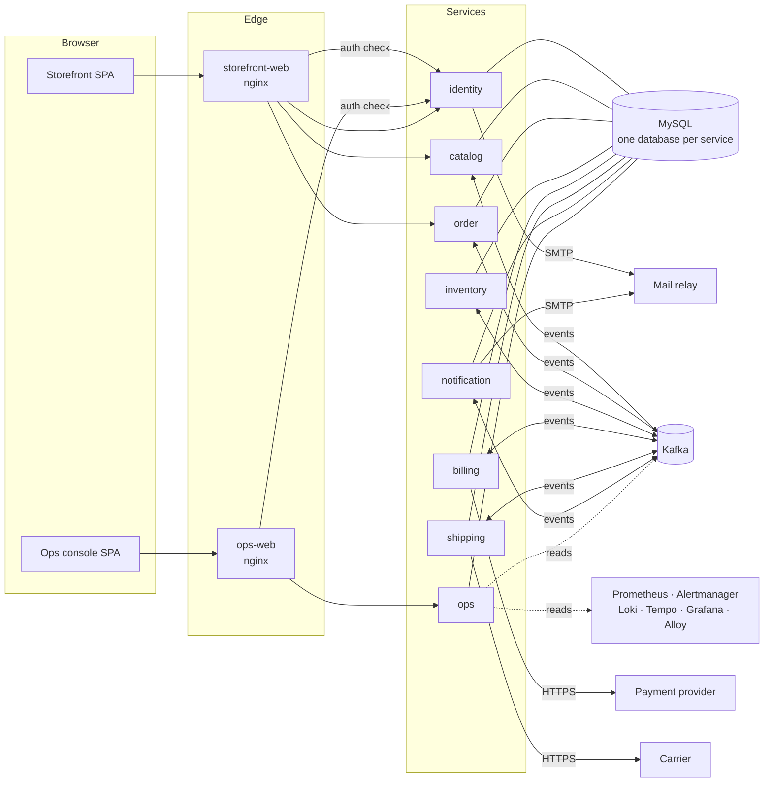

# Commerce

An e-commerce store front built as event-driven microservices: Spring Boot 4.1
(Java 25), Kafka, MySQL and React, run with Docker Compose.

It has two goals:

1. **A fully functional web store built the way a high-traffic one should be** —
   highly available, low latency, high throughput, and observable end to end
   (logs, metrics, traces, alerts).
2. **A DEV environment where you can watch it work.** Simulated shoppers place,
   cancel and return orders; you add and stop misbehaving producers and consumers
   from the monitoring site and see, in real time, that bad data and bad players
   do not take the system down.

> **Status: built, with CI/CD.** Every milestone of the plan is done except the
> load baseline (milestone 11). The architecture and every design decision were
> written down before the code, and still describe it; what exists and what is
> left is in [docs/implementation-plan.md](docs/implementation-plan.md).

## Documentation

| Document | What's in it |
|---|---|
| [docs/architecture.md](docs/architecture.md) | The system: services, data, events, the order / cancel / return flows, the edge, observability, networks, environments, the monitoring site, the DEV simulator and chaos lab, CI/CD |
| [docs/decisions.md](docs/decisions.md) | Every architecture and design decision (ADR-001 …), with the alternatives rejected and why |
| [docs/implementation-plan.md](docs/implementation-plan.md) | The build specification: repository layout, current state, conventions, per-module specs (tables, endpoints, classes, config), build order with acceptance checks, verified facts and gotchas |
| [docs/api.md](docs/api.md) | Every endpoint, through the two edges |
| [docs/configuration.md](docs/configuration.md) | Every setting of every environment, and CD's |
| [docs/operations.md](docs/operations.md) | How issues are discovered, alerted, tracked and debugged: signals, alert rules, the incident workflow, runbooks, and what the resilience experiments observed |
| [docs/design-review.md](docs/design-review.md) | The pre-development review: improvements already folded in, and the decisions still open |
| [docs/identity/](docs/identity/) | The identity service (from [Bastion](https://github.com/paulhenninger/bastion)): security model, API, configuration, operations |
| [AGENTS.md](AGENTS.md) | Rules for AI coding agents working in this repository |

## The system in one picture



- **Browsers talk only to the edge.** nginx serves each SPA, authenticates every
  API call by asking the identity service, and forwards it with the caller's
  identity in headers. Domain services never see a token.
- **Services talk to each other only through Kafka events.** No service calls
  another's API. Each owns its database; state changes and the events announcing
  them commit together (transactional outbox).
- **Everything a service cannot process goes to a dead-letter topic**, never
  blocking a partition. Consumers are idempotent, so duplicates and replays are
  harmless.
- **Every request is traceable** from the browser's response header through each
  service and Kafka hop, in logs (Loki), traces (Tempo) and metrics (Prometheus).

## Services

| Service | Owns | Deployed to |
|---|---|---|
| `identity` | Accounts, sign-in, 2FA, passkeys, sessions (Bastion) | all |
| `catalog` | Products, prices, a read model of availability | all |
| `order` | Orders and the order saga (place → pay → ship → return) | all |
| `inventory` | Stock and reservations | all |
| `billing` | Payments and refunds, via the payment provider | all |
| `shipping` | Shipments and return shipments, via the carrier | all |
| `notification` | Customer emails | all |
| `ops` | The monitoring API: health, metrics, Kafka state, incidents | all |
| `storefront-web`, `ops-web` | The two edges and their SPAs | all |
| `simulators` | Fake payment provider and carrier, with fault injection | **dev only** |
| `testkit` | Test data, simulated shoppers, problem producers/consumers, event tap | **dev only** |
| `mailpit` | Mail catcher | **dev only** |
| `controller`, `docker-proxy` | Start/stop instances and run resilience experiments from the console | **dev only** |

## Environments

| | dev | int | qa | prod |
|---|---|---|---|---|
| Test data, simulated shoppers, chaos lab | yes | — | — | — |
| Simulated payment provider and carrier, Mailpit | yes | — | — | — |
| External endpoints (payment, carrier, SMTP) | built in | required | required | required |
| Service replicas | 2 (1 with `--lite`) | 1 | 2 | 2+ |
| Kafka brokers / replication | 3 / 3 (1 / 1 with `--lite`) | 1 / 1 | 3 / 3 | 3 / 3 |
| Instance start/stop controls, resilience experiments | yes | — | — | — |
| Kafka authentication and ACLs | yes | yes | yes | yes |
| Trace sampling | 100% | 100% | 100% | 10% |
| Debug ports (MySQL, Kafka) published | yes | — | — | — |

INT, QA and PROD are the same clean deployment at different scales. A service
started outside DEV refuses to run if any setting points at a test facility, and
CI fails if a DEV-only container appears in another environment's Compose model.

## Running it

You need Docker (give Docker Desktop 8–10 GB of memory for the default HA
topology), bash (Git Bash on Windows), curl and Python 3.

```bash
git clone https://github.com/paulhenninger/commerce.git && cd commerce
scripts/stack.sh dev up -d --build --wait    # the DEV stack: ~10 min the first time
scripts/smoke.sh                             # 61 end-to-end checks
scripts/prove.sh --quick                     # four resilience experiments, ~12 min
```

The first `stack.sh dev` creates `deploy/env/dev.env` with freshly generated
secrets. `scripts/stack.sh dev --lite up -d --build --wait` runs single instances
and one broker instead (less memory; the HA experiments then report
`NOT_APPLICABLE`). `scripts/stack.sh dev down` stops it; add `-v` to delete its data.

| URL (dev) | What |
|---|---|
| http://localhost:8081 | Storefront (and its back office, for administrators) |
| http://localhost:8082 | Ops console: monitoring, Kafka and dead letters, incidents, instances, traffic simulator, chaos lab, resilience proofs |
| http://localhost:3000 | Grafana (dashboards, logs, traces) |
| http://localhost:8025 | Mailpit (every email the system sends) |

DEV seeds two accounts: `admin@example.com` (administrator) and
`shopper@example.com`; their passwords are `DEV_ADMIN_PASSWORD` and
`DEV_SHOPPER_PASSWORD` in `deploy/env/dev.env`.

INT, QA and PROD are deployed by CD from the images CI tested; see
[docs/configuration.md](docs/configuration.md#cd-github) and
[docs/operations.md](docs/operations.md#7-routine-operations).

## Key decisions at a glance

The full list, with reasoning, is in [docs/decisions.md](docs/decisions.md).

| # | Decision |
|---|---|
| 001 | Microservices by business capability, one database per service |
| 002 | Services integrate only through Kafka events; no synchronous service-to-service calls |
| 003 | Choreographed saga with the order service as the single owner of order state |
| 004 | Transactional outbox for publishing; idempotent consumers (inbox) for consuming |
| 005 | Retries with backoff, then a dead-letter topic; contract failures are never retried |
| 006 | One JSON event envelope; contracts as a shared, versioned library; tolerant readers |
| 007 | Authentication at the edge: nginx asks identity on every request, services trust edge headers |
| 008 | Identity is Bastion, copied and renamed; its security controls are not weakened |
| 009 | Placing an order is asynchronous (202 + status), so checkout latency is independent of payment |
| 010 | Product and price data reach other services as events (no cross-service reads) |
| 011 | Observability: ECS JSON logs → Loki, OTLP traces → Tempo, Prometheus metrics, one Grafana |
| 012 | Alerts flow Prometheus → Alertmanager → the ops service, which tracks them as incidents |
| 013 | A custom ops console over Prometheus and Kafka, alongside Grafana |
| 014 | Test tooling is DEV-only, enforced three ways (Compose, startup guard, CI) |
| 015 | External dependencies behind timeouts, a circuit breaker and idempotency keys |
| 016 | Hardened containers and segmented networks everywhere |
| 017 | One Gradle multi-project build, one Dockerfile, one image per service |
| 018 | CI on every change; CD promotes the same images dev → int → qa → prod |
| 021 | Simulated shoppers are real accounts going through the real edge |
| 022 | A back office for products, stock and order lookup |
| 023 | A live event feed over Server-Sent Events |
| 024 | Kafka clients authenticate; each service may write only its own topics |
| 026 | DEV, QA and PROD run one HA topology (replicas, three brokers) |
| 027 | Instances are started and stopped from the console, through a narrow dev-only path |
| 028 | Resilience is proven by experiments with pass/fail verdicts |

## Credits and licence

The identity service and the storefront's account pages come from
[Bastion](https://github.com/paulhenninger/bastion) (MIT). See [LICENSE](LICENSE).
