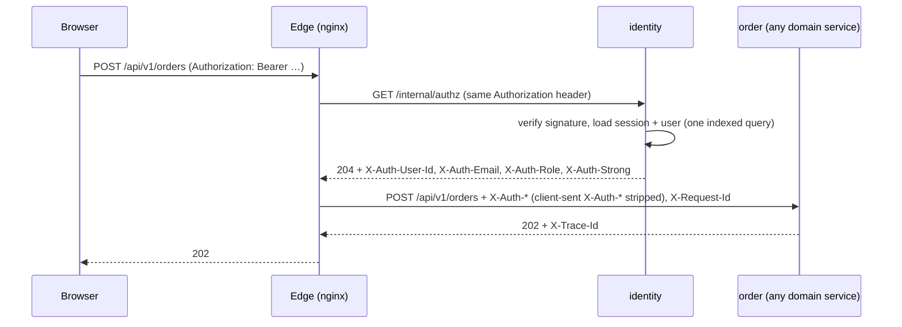
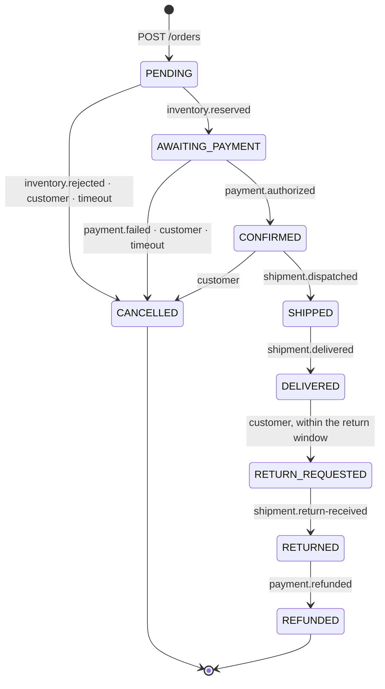
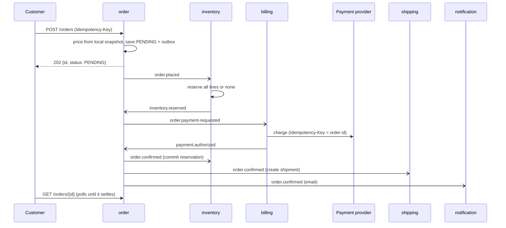
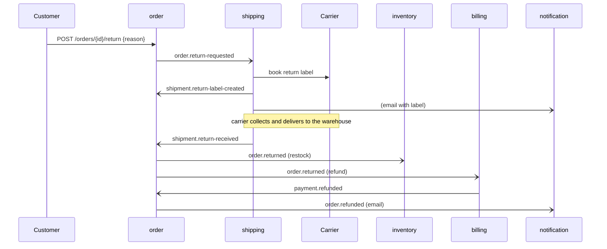
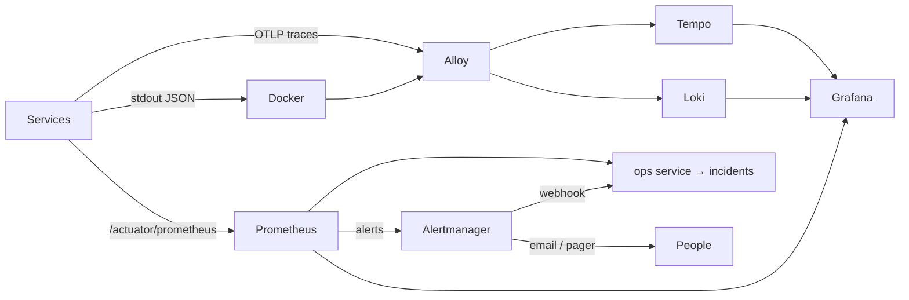

# Architecture

This describes the system as designed. Where the reasoning for a choice matters,
it links to the decision record in [decisions.md](decisions.md). How to build it
is in [implementation-plan.md](implementation-plan.md).

- [1. Goals and constraints](#1-goals-and-constraints)
- [2. Components](#2-components)
- [3. The edge and authentication](#3-the-edge-and-authentication)
- [4. Data ownership](#4-data-ownership)
- [5. Events](#5-events)
- [6. Business flows](#6-business-flows)
- [7. Reliability](#7-reliability)
- [8. Performance](#8-performance)
- [9. Observability](#9-observability)
- [10. The monitoring site](#10-the-monitoring-site)
- [11. DEV-only tooling](#11-dev-only-tooling)
- [12. Deployment](#12-deployment)
- [13. Security](#13-security)
- [14. CI/CD](#14-cicd)
- [15. Known limits](#15-known-limits)

## 1. Goals and constraints

| Goal | What it means here |
|---|---|
| Fully functional store | Browse, cart, checkout, pay, ship, cancel, return, refund; accounts with 2FA and passkeys; customer emails |
| High availability | Stateless services run as replicas; any replica can die mid-request or mid-event without losing or duplicating work; a failed dependency degrades one feature, not the site |
| Low latency | Reads are cached at three levels; checkout answers before payment completes; no request waits on another service |
| High throughput | Partitioned topics consumed in parallel; batched, compressed producing; virtual threads; bounded pools and queues everywhere |
| Monitoring and traceability | Any request or order can be followed across every service and Kafka hop from one id; problems raise alerts that are tracked to resolution |
| Resilience to bad data and bad players | Malformed, duplicate, oversized, out-of-order and flood traffic, and slow or crashing consumers, are contained — and DEV lets you prove it live |
| Clean higher environments | Test data, simulated shoppers, simulators, Mailpit and chaos tooling exist only in DEV |

Fixed by the brief: Spring Boot, Kafka, MySQL, React, Docker Compose, and
[Bastion](https://github.com/paulhenninger/bastion) for accounts and sign-in.
Base Java package: `com.thirdstone.commerce`.

## 2. Components

### Application services

| Service | Responsibility | Database | Publishes to | Consumes from |
|---|---|---|---|---|
| `identity` | Accounts, sign-in, sessions, 2FA, passkeys, admin; answers the edge's auth check | `identity` | — | — |
| `catalog` | Products and prices; public browse and search API; availability read model | `catalog` | catalog | stock |
| `order` | Orders; owns order state and drives the saga; order API | `orders` | order | inventory, billing, shipping, catalog |
| `inventory` | Stock levels and per-order reservations | `inventory` | inventory, stock | order, catalog |
| `billing` | Payments and refunds through the payment provider | `billing` | billing | order |
| `shipping` | Outbound and return shipments through the carrier | `shipping` | shipping | order |
| `notification` | Customer emails | `notification` | — | order, shipping |
| `ops` | Monitoring API for the ops console: health, metrics, Kafka state, dead letters, incidents; proxy to the DEV testkit | `ops` | dead-letter replays only | every topic (a read-only live-feed group; also the admin API) |

### Edges and web apps

| Component | What it is |
|---|---|
| `storefront-web` | nginx: serves the storefront SPA; proxies `/api/v1/auth`, `/api/v1/users`, `/api/v1/admin` → identity, `/api/v1/catalog` → catalog, `/api/v1/orders` → order, and the back-office routes `/api/v1/backoffice/{catalog,inventory,orders}` → catalog, inventory, order (administrators with a two-factor session only) |
| `ops-web` | nginx: serves the ops console SPA; proxies `/api/v1/auth`, `/api/v1/users` → identity and `/api/v1/ops` → ops (administrators only) |
| Storefront SPA | React 19 + Vite + TypeScript: Bastion's account pages plus catalog, product, cart, checkout, orders, order detail with live status; for administrators a back office (products and prices, stock levels, order lookup with full history) beside Bastion's user administration |
| Ops console SPA | React 19 + Vite + TypeScript: overview, services, Kafka, business, incidents; in DEV also the traffic simulator and chaos lab |

### Infrastructure

| Component | Role |
|---|---|
| MySQL 9.7 | One server, one database and two logins (owner, app) per service |
| Kafka 4.4 (KRaft) | Event backbone; 3 brokers in dev, qa and prod; 1 in int and in dev's lite mode; clients authenticate and are authorised per service |
| Prometheus | Scrapes every service's management port; evaluates alert rules |
| Alertmanager | Groups and routes alerts: to the ops service (always) and to people (per environment) |
| Loki | Log store |
| Tempo | Trace store |
| Alloy | Collector: tails every container's stdout into Loki; receives OTLP traces and forwards them to Tempo |
| Grafana | Dashboards and exploration across metrics, logs and traces, pre-provisioned |
| mysqld-exporter | MySQL server metrics for Prometheus |

### DEV-only

| Component | Role |
|---|---|
| `simulators` | A fake payment provider and a fake carrier, with latency, error-rate and outage switches |
| `testkit` | Seeds test data and accounts; runs simulated shoppers (purchases, cancellations, returns); runs problem producers and consumers; taps every topic and verifies event contracts |
| `mailpit` | Catches every email |
| `controller` | Starts, stops, kills and pauses the instances of this deployment on request from the ops console; runs resilience experiments |
| `docker-proxy` | The only container that touches the Docker socket; exposes just "list, start, stop, kill, pause, restart a container" to the controller |

## 3. The edge and authentication

([ADR-007](decisions.md#adr-007-authentication-at-the-edge), [ADR-008](decisions.md#adr-008-identity-is-bastion))



- Bastion issues a 15-minute HS256 access token held in the SPA's memory and a
  rotating refresh token in an `HttpOnly`, `SameSite=Strict` cookie. That is
  unchanged.
- Only identity holds the signing key. The edge calls identity's
  `GET /internal/authz` (nginx `auth_request`) for every authenticated API call;
  identity re-reads the session and user each time, so sign-out, lock and role
  change take effect on the next request everywhere. There is no cache on this
  check.
- `/internal/authz?require=admin` additionally requires role `ADMIN` and — when
  `OPS_REQUIRE_MFA=true`, the default outside dev — a two-factor session. `ops-web`
  uses it for everything under `/api/v1/ops`.
- The edge always overwrites `X-Auth-*` and `X-Request-Id`; `/internal/**` and
  `/actuator/**` are never proxied. Domain services are on networks only the
  edges can reach.
- Defence in depth: the edge also sends `X-Edge-Token`, a secret shared by the
  edges and the services (`EDGE_SHARED_SECRET`). A service ignores `X-Auth-*`
  on any request without the right token, so a container that somehow reaches a
  service's port still cannot claim to be a user.
- Public routes (catalog browse, `/api/v1/auth/**`) skip the auth check.
- A domain service reads the caller from the headers (`Caller` in platform:core)
  and scopes data by `caller.userId()`. Someone else's order is a 404, not a 403.
- 401 always means "no valid session — refresh or sign in"; authorisation failures
  are 403, so the SPA's silent-refresh logic never loops.

### Edge behaviour

| Concern | Setting |
|---|---|
| Upstreams | `upstream` blocks with `resolve` (re-resolves Docker DNS, so replicas come and go), `keepalive`, passive health checks (`max_fails`, `fail_timeout`) |
| Retries | `proxy_next_upstream` for idempotent methods only, on connect error/timeout/502/503/504 |
| Timeouts | connect 2 s, read 15 s, client header/body 10 s |
| Rate limits | Per client IP: API 50 r/s burst 100; auth routes 10 r/s burst 20 (Bastion's finer per-endpoint and per-account limits sit behind this). Per signed-in user: `POST /orders` 2 r/s burst 5 |
| Catalog micro-cache | `GET /api/v1/catalog/**` cached 5 s, `proxy_cache_lock on`, served stale on upstream error/timeout/5xx for up to 10 min |
| Body size | 64 KiB |
| Compression | gzip for JSON, JS, CSS, SVG |
| Static assets | hashed assets `immutable`, `index.html` `no-cache` |
| Security headers | Bastion's CSP and header set, unchanged for the storefront; the same set for the ops console |
| Access log | path only (no query string), with request id, upstream time and upstream trace id |

## 4. Data ownership

([ADR-001](decisions.md#adr-001-microservices-one-database-per-service))

One MySQL database per service. A service reads and writes only its own. Each has
two logins, following Bastion: `<db>_owner` runs Flyway migrations at startup,
`<db>_app` can only read and write rows. TLS is required on every connection.
There are no cross-database foreign keys; a `user_id` or `sku` in another
service's table is just a value.

| Database | Tables (beyond the messaging tables) |
|---|---|
| `identity` | Bastion's schema, unchanged |
| `catalog` | `products` (incl. the `available` projection) |
| `orders` | `orders`, `order_lines`, `order_history`, `products` (price snapshot from catalog events) |
| `inventory` | `stock`, `reservations` |
| `billing` | `payments` |
| `shipping` | `shipments` |
| `notification` | `notifications` |
| `ops` | `incidents`, `incident_notes` |

Every event-driven service also has `outbox_events` and `processed_events`
(section 7). Money is integer cents with an ISO currency code; timestamps are UTC.

## 5. Events

([ADR-002](decisions.md#adr-002-events-only-between-services), [ADR-006](decisions.md#adr-006-event-envelope-and-contracts))

### Topics

| Topic | Owner (only writer) | Key | Partitions |
|---|---|---|---|
| `commerce.order.events.v1` | order | order id | 6 |
| `commerce.inventory.events.v1` | inventory | order id | 6 |
| `commerce.inventory.stock.v1` | inventory | SKU | 6 |
| `commerce.billing.events.v1` | billing | order id | 6 |
| `commerce.shipping.events.v1` | shipping | order id | 6 |
| `commerce.catalog.events.v1` | catalog | SKU | 3 |
| `<topic>.dlt` (one per topic above) | any consumer of the topic | original key | 1 |

Keying by aggregate id puts everything about one order on one partition, so each
consumer sees an order's events in the order they were written. Retention is
7 days for event topics and 30 days for dead-letter topics. Replication factor
and `min.insync.replicas` come from the environment (3/2 on the HA topology — dev, qa and prod — and 1/1 in int and in
dev's lite mode). Topics are created, with their access rules, by a one-shot `kafka-init` job at
deployment; services cannot create topics and broker auto-creation is off.

### Access control

([ADR-024](decisions.md#adr-024-kafka-authentication-and-acls))

The broker, not just the consumers, decides who may do what. Every client
authenticates (SASL/SCRAM-SHA-512) as its service's own principal, and an
authorizer denies anything not explicitly allowed.

| Principal | May |
|---|---|
| each domain service (`order`, `inventory`, …) | **Write** only its own topic(s); **read** only the topics it consumes, with its own consumer group; **write** to the `.dlt` of topics it consumes |
| `ops` | Describe the cluster, topics and groups; read every topic (live feed, dead letters) with its `ops-*` groups; write to event topics **only** to replay a dead letter — the single exception to "only the owner writes", audited |
| `kafka-init` (admin) | Create topics and access rules at deployment; not used at run time |
| brokers | Inter-broker and controller traffic |
| `testkit` (dev) | Read every topic with its `testkit-*` groups |
| `testkit-chaos` (dev) | Write to every event topic — it plays "a legitimate producer gone wrong", so the consumers' defences can be exercised |
| `intruder` (dev) | Authenticates, but is allowed nothing — it plays "a client that should not be here" |

Consequences: a service cannot publish another service's events even if it is
compromised or buggy; a client with no rights cannot write, read, or join a
service's consumer group and stall it; and the chaos lab can show both layers —
the broker refusing an intruder, and consumers containing bad data from a
producer the broker does trust. Credentials and rules are created by
`kafka-init`; passwords come from the environment like every other secret.

### Envelope

```json
{
  "eventId": "6f1c…",            // unique; consumers dedupe on it
  "type": "order.placed",        // what happened
  "version": 1,                  // payload contract version
  "occurredAt": "2026-11-16T12:00:00Z",
  "source": "order",             // writing service
  "aggregateId": "01JD…",        // also the record key
  "payload": { }
}
```

Kafka headers: `traceparent` (W3C trace context of the request or event that
caused this one), `event-type` (copy of `type`, for filtering without parsing).

### Catalogue

Common shapes: `Line {sku, name, quantity, unitPriceCents}`,
`Address {name, line1, city, postalCode, country}`.

| Type | Topic | Payload | Consumed by → effect |
|---|---|---|---|
| `product.upserted` | catalog | `sku, name, priceCents, currency, active` | order → price snapshot; inventory → ensure a stock row exists |
| `inventory.stock-changed` | stock | `sku, available` | catalog → `available` projection |
| `order.placed` | order | `orderId, userId, email, lines[], totalCents, currency` | inventory → reserve |
| `inventory.reserved` | inventory | `orderId` | order → request payment |
| `inventory.rejected` | inventory | `orderId, reason, sku` | order → cancel |
| `order.payment-requested` | order | `orderId, userId, amountCents, currency, paymentMethod, expiresAt` | billing → charge, unless past `expiresAt` |
| `payment.authorized` | billing | `orderId, paymentId, amountCents, currency, providerRef` | order → confirm |
| `payment.failed` | billing | `orderId, reason` | order → cancel |
| `order.confirmed` | order | `orderId, userId, email, lines[], totalCents, currency, shippingAddress` | inventory → commit reservation; shipping → create shipment; notification → email |
| `order.cancelled` | order | `orderId, userId, email, reason, totalCents, currency` | inventory → release or restock; billing → refund if charged; shipping → cancel if not dispatched; notification → email |
| `shipment.created` | shipping | `orderId, shipmentId, carrier, trackingNumber` | order → record tracking number |
| `shipment.dispatched` | shipping | `orderId, userId, email, carrier, trackingNumber` | order → `SHIPPED`; notification → email |
| `shipment.delivered` | shipping | `orderId, userId, email, trackingNumber` | order → `DELIVERED`; notification → email |
| `order.return-requested` | order | `orderId, userId, email, lines[], pickupAddress, reason` | shipping → create return shipment |
| `shipment.return-label-created` | shipping | `orderId, userId, email, carrier, trackingNumber` | order → record return tracking; notification → email with the label |
| `shipment.return-received` | shipping | `orderId, trackingNumber` | order → `RETURNED` |
| `order.returned` | order | `orderId, userId, email, lines[], totalCents, currency` | inventory → restock; billing → refund |
| `payment.refunded` | billing | `orderId, paymentId, amountCents, currency` | order → `REFUNDED` (returned orders) or history entry (cancelled orders) |
| `order.refunded` | order | `orderId, userId, email, amountCents, currency` | notification → email |

Rules every consumer follows:

- An event type it does not handle is skipped and counted, never an error.
- Unknown fields are ignored; a missing required field is a contract failure.
- An event that does not apply to the current state (a `payment.authorized` for a
  cancelled order, an event for an unknown order) is acknowledged and counted as
  `ignored`. State changes are conditional updates, so they are safe to repeat
  and safe to receive out of order.

## 6. Business flows

([ADR-003](decisions.md#adr-003-choreographed-saga-owned-by-the-order-service), [ADR-009](decisions.md#adr-009-asynchronous-order-placement))

### Order states



Every transition is one conditional `UPDATE … WHERE id = ? AND status IN (…)`
plus an `order_history` row and, where the table in section 5 says so, an outbox
event — in one transaction. An update that matches no row means the event no
longer applies and is ignored.

### Placing an order



- The price comes from the order service's own copy of the catalog, never from
  the client. The client sends the total it showed the customer; if the server's
  total differs (a price changed since the cart was filled) the answer is
  `409 PRICE_CHANGED` with the current prices, and nothing is ordered. An unknown
  or inactive SKU, or a quantity outside 1–20, is a 400.
- **Load shedding**: when more than `ORDER_MAX_IN_FLIGHT` orders (default 5000)
  are `PENDING` or `AWAITING_PAYMENT`, new orders get `503` with `Retry-After`
  rather than joining a queue that would only time out.
- `Idempotency-Key` (required, a UUID the SPA generates per checkout attempt)
  makes a retried `POST` return the first order instead of creating a second.
- Failure paths: `inventory.rejected` → `CANCELLED (OUT_OF_STOCK)`;
  `payment.failed` → `CANCELLED (PAYMENT_DECLINED | PAYMENT_UNAVAILABLE)`, and
  inventory releases the reservation on `order.cancelled`.
- **Timeout**: a scheduler in the order service cancels orders still `PENDING` or
  `AWAITING_PAYMENT` after `ORDER_SAGA_TIMEOUT` (default 2 min) with reason
  `TIMEOUT`. The normal cancellation compensations then run. No order waits
  forever on a service that is down.
- **Deadlines travel with requests**: `order.payment-requested` carries
  `expiresAt` (placement time + the saga timeout). Billing refuses to charge an
  expired request and answers `payment.failed (EXPIRED)`, so a billing service
  that comes back after an outage does not charge — and then refund — orders
  that were already cancelled.

### Cancelling

`POST /orders/{id}/cancel` is allowed in `PENDING`, `AWAITING_PAYMENT` and
`CONFIRMED`. The order service emits `order.cancelled`; each service compensates
for whatever it had done:

| Service | Compensation |
|---|---|
| inventory | reservation `RESERVED` → release; `COMMITTED` → restock |
| billing | payment `AUTHORIZED` → refund, emit `payment.refunded` |
| shipping | shipment not yet dispatched → `CANCELLED` |

Because `order.payment-requested` and `order.cancelled` share a topic and key,
billing always sees them in order: a cancellation that arrives after the charge
refunds it; one that arrives before leaves a `CANCELLED` marker that makes the
later charge request a no-op. If the carrier dispatches before shipping sees the
cancellation, `shipment.dispatched` reaches an order that is already cancelled
and is ignored; the parcel is then handled as a return by support (out of scope).

### Returning



Whole-order returns only, within `RETURN_WINDOW_DAYS` (default 30) of delivery.
The refund is issued when the warehouse receives the parcel, not on request.

### Shipping's carrier work

Shipping never calls the carrier from an event handler. A handler only records a
shipment as `PENDING`; a worker (`SELECT … FOR UPDATE SKIP LOCKED`, so replicas
share the work) books pending shipments and polls the carrier for the status of
booked ones, emitting events as they progress. A carrier outage delays shipments
and nothing else.

Shipment states — outbound: `PENDING → CREATED → DISPATCHED → DELIVERED`
(or `CANCELLED`); return: `PENDING → CREATED → IN_TRANSIT → RECEIVED`.

## 7. Reliability

### Publishing: transactional outbox

([ADR-004](decisions.md#adr-004-transactional-outbox-and-idempotent-consumers))

A service never writes to Kafka in a request or handler. It inserts the event
into its `outbox_events` table in the same transaction as the state change. A
relay in each service publishes outbox rows to Kafka in id order and deletes
them once the broker has acknowledged.

- Either both the state change and the event happen, or neither.
- The relay is woken the moment a transaction that wrote to the outbox commits,
  so an event normally leaves within a few milliseconds; it also polls every
  500 ms, which is what picks up rows after a crash or a Kafka outage.
- The relay takes a MySQL advisory lock (`GET_LOCK`) for each pass, so with
  several replicas exactly one publishes at a time and per-key order is kept; if
  it dies another replica takes over on its next pass.
- Producer: `acks=all`, idempotence on, `lz4`, `linger.ms=5`.
- A crash between "broker acknowledged" and "row deleted" republishes the row:
  delivery is at-least-once, which the consumers absorb.
- The row stores the `traceparent` of the request or event that caused it; the
  relay sets it on the record, so traces continue across the outbox.

### Consuming: idempotent, retried, dead-lettered

([ADR-005](decisions.md#adr-005-retry-then-dead-letter))

For each record a listener:

1. Parses and validates the envelope. Failure → **dead-letter immediately**.
2. Finds a handler for the type. None → skip, count `ignored`.
3. Opens a transaction; inserts the event id into `processed_events`
   (`INSERT IGNORE`). Already there → skip, count `duplicate`.
4. Runs the handler (state change + outbox rows) and commits.

`processed_events` rows older than the topics' retention (7 days) are purged
nightly: an event that old can no longer be redelivered.

A handler that throws is retried in place 3 times (200 ms, 800 ms, 3.2 s); if it
still fails the record goes to `<topic>.dlt` with the exception, original topic,
partition, offset and consumer group in its headers, and the partition moves on.
Contract failures (`InvalidEventException`) skip the retries.

| Bad input | What contains it |
|---|---|
| Malformed bytes, wrong shape, missing fields | Envelope and payload validation → dead letter, no retry |
| Oversized records | Broker `message.max.bytes` (1 MiB) rejects at produce; codec rejects > 256 KiB |
| Duplicate or replayed events | `processed_events` |
| Events for unknown or already-moved-on aggregates | Conditional updates → `ignored` |
| Unknown event types | Skipped |
| A flood of valid-looking events | Bounded `max.poll.records`, per-record cost is one indexed lookup; lag alerts fire; real traffic on other partitions/topics is unaffected by back-pressure in one group |
| A slow, crashing or flapping consumer | It has its own consumer group; other groups' progress is independent |
| A poison event that makes a handler throw every time | Retries → dead letter |

Handlers that must call an external system (billing) do so **before** the
transaction — the call carries the order id as its idempotency key, so a
redelivery repeats it harmlessly — and only then open the transaction that
records the outcome. No database transaction is held open across a network call.

### External dependencies

([ADR-015](decisions.md#adr-015-external-dependencies))

| Dependency | Protection |
|---|---|
| Payment provider | 1 s connect / 3 s read timeouts; one retry on connect error or 5xx; circuit breaker (Resilience4j: opens at 50% failures over 20 calls, half-opens after 10 s); an unavailable provider becomes `payment.failed (PAYMENT_UNAVAILABLE)` so the order is cancelled promptly and stock released |
| Carrier | Same timeouts and breaker; called only from the shipping worker, which simply tries again on its next pass |
| SMTP | 5 s timeouts; called only from the notification worker (handlers just record the email to send), which retries with backoff for up to 24 h, then marks it `FAILED` and counts it; an email is never in the path of an order |

### Failure matrix

| What fails | Effect | Recovery |
|---|---|---|
| A service replica | Edge retries idempotent requests on another replica; its Kafka partitions rebalance to the survivors | Automatic |
| All replicas of catalog | Browsing served from the edge cache (stale up to 10 min); product pages not in cache fail | Automatic on restart |
| All replicas of order | Checkout and order pages return 503; nothing in flight is lost (events wait in Kafka) | Automatic on restart |
| inventory, billing or shipping down | Orders are accepted and wait; past the saga timeout they are cancelled and compensated | Events drain on restart |
| notification down | Emails are delayed | Events drain on restart |
| identity down | Authenticated calls fail (401/503); public catalog browsing still works | Automatic on restart |
| A Kafka broker (HA topology) | Leaders move; producers and consumers continue (`min.insync.replicas=2`) | Automatic |
| Kafka entirely | Requests still succeed (events queue in the outbox); sagas pause; outbox alerts fire | Outbox drains on recovery |
| MySQL | The services using it fail their readiness probe and return 503 | Restart / failover (see section 15) |
| Payment provider | Breaker opens; orders cancelled with `PAYMENT_UNAVAILABLE` | Breaker closes by itself |
| Observability stack | No effect on the store | — |

### Health and shutdown

Liveness and readiness probes on the management port. Readiness includes the
service's database and nothing else: with Kafka down a service can still answer
requests (events wait in the outbox), so Kafka's state is reported in health
details and alerts but never takes a service out of rotation. Compose
healthchecks and `depends_on: service_healthy` use readiness. On SIGTERM a service stops accepting requests, finishes in-flight
requests and the current Kafka batch (20 s budget), and exits.

## 8. Performance

| Technique | Where |
|---|---|
| Three-level read caching: browser (`Cache-Control: public, max-age=5`), edge micro-cache (5 s, stale-on-error), in-process Caffeine cache (5 s) | catalog reads |
| Asynchronous checkout: `202` after one local transaction | order |
| No synchronous service-to-service calls; local copies of the data a service needs | all |
| Virtual threads for request handling and Kafka listeners | all |
| Bounded Tomcat connections and accept queue; bounded HikariCP pools (10 per replica) with a 2 s acquisition timeout | all |
| Kafka: 6 partitions per saga topic, listener concurrency 3 per replica, batched and compressed producing | event-driven services |
| Outbox relay batches of 200 with one flush | event-driven services |
| Indexed access paths only; conditional single-statement updates instead of read-modify-write; row locks taken in SKU order | all |
| Keep-alive upstream connections; gzip; immutable hashed assets | edges |
| Pagination capped at 50 per page | list endpoints |

Targets used for alert thresholds and capacity checks (not yet measured — see
the implementation plan's load-test step): catalog reads p95 < 100 ms at the
edge; `POST /orders` p95 < 250 ms; place → confirmed p95 < 3 s with a healthy
payment provider.

## 9. Observability

([ADR-011](decisions.md#adr-011-observability-stack), [ADR-012](decisions.md#adr-012-alerting-and-incident-tracking))



### Logs

- Every service writes one JSON object per line (Elastic Common Schema) to
  stdout. Alloy tails every container through the Docker API and ships to Loki
  with labels `environment`, `service`, `container`, `level`.
- Every line carries `traceId` and `spanId`; request-scoped lines also carry
  `requestId` and `userId`; event-handling lines carry `eventId`, `eventType`,
  `orderId` (or the aggregate id).
- Levels: `INFO` for business milestones (one line per state change), `WARN` for
  handled anomalies (ignored event, retry, breaker open), `ERROR` for what needs a
  human (dead-lettered record, unhandled exception). No secrets, tokens, card
  data or full addresses in logs.
- Identity keeps Bastion's separate `commerce.audit` security log.

### Traces

- Work started later by a worker continues the trace that asked for it: the
  outbox relay sets the stored `traceparent` on the record, and the notification
  worker sends each email in a span whose parent is the event that queued it. So a
  trace runs from the click to the email; `scripts/verify-observability.py` checks
  that one does. Scheduled polls themselves create no spans
  (`management.observations.enable.tasks.scheduled=false`): one per poll every few
  seconds would bury everything else.
- OpenTelemetry via Spring Boot's starter; W3C `traceparent` propagation; spans
  for HTTP server and client calls, JDBC is not traced, Kafka listener
  invocations, and the outbox relay's publish.
- A trace covers a whole business flow: the `POST /orders` span is the parent of
  inventory's handling of `order.placed`, which is the parent of the order
  service's handling of `inventory.reserved`, and so on to the confirmation email.
- Every HTTP response carries `X-Trace-Id` and `X-Request-Id`; the storefront
  shows the request id on error messages.
- Sampling: 100% in dev, int and qa; 10% in prod (parent-based).

### Metrics

Scraped from each service's management port (never proxied by an edge) every 5 s in every environment (one
configuration; at this size the cost is small). All carry `application` and `environment` tags.

| Metric | Type | Tags | Meaning |
|---|---|---|---|
| `http_server_requests_seconds` | histogram | uri, method, status, outcome | Request rate, errors, latency (RED) |
| `jvm_*`, `process_*`, `hikaricp_*`, `tomcat_*` | — | — | Runtime saturation (USE) |
| `kafka_consumer_*`, `kafka_producer_*` | — | client id | Kafka client health |
| `commerce_events_consumed_total` | counter | consumer, type, outcome=`processed\|duplicate\|ignored\|invalid\|failed` | What each consumer did with each event |
| `commerce_event_processing_seconds` | histogram | consumer, type | Handler latency |
| `commerce_events_dead_lettered_total` | counter | consumer, topic, reason | Records sent to a dead-letter topic |
| `commerce_outbox_pending` | gauge | — | Rows waiting to be published |
| `commerce_outbox_oldest_age_seconds` | gauge | — | Age of the oldest waiting row |
| `commerce_outbox_published_total` | counter | topic | Events published |
| `commerce_orders_total` | counter | outcome=`placed\|confirmed\|cancelled\|returned\|refunded`, reason | Business flow |
| `commerce_orders_by_status` | gauge | status | Orders currently in each state |
| `commerce_order_saga_seconds` | histogram | outcome | Place → confirmed/cancelled duration |
| `commerce_revenue_cents_total`, `commerce_refunds_cents_total` | counter | currency | Money in and out |
| `commerce_payments_total` | counter | outcome | Provider results |
| `commerce_external_calls_seconds` | histogram | target, outcome | Payment provider and carrier latency |
| `resilience4j_circuitbreaker_state` | gauge | name, state | Breaker state |
| `commerce_stock_available` | gauge | sku | Stock (inventory) |
| `commerce_kafka_consumer_lag` | gauge | group, topic | Lag per group and topic (from ops) |
| `commerce_kafka_topic_end_offset` | gauge | topic | Messages ever written, incl. dead-letter topics (from ops) |
| `commerce_kafka_brokers`, `commerce_kafka_under_replicated_partitions` | gauge | — | Cluster health (from ops) |
| `commerce_security_events_total` | counter | type | Bastion's security events (identity) |

### Alerts

Rules live in `deploy/observability/prometheus/rules/`. The full list, with
thresholds and the runbook for each, is in [operations.md](operations.md).
Alertmanager groups by alert and service, sends everything to the ops service's
webhook (which records it as an incident), and additionally notifies people:
Mailpit in dev, the configured receiver elsewhere.

### Dashboards

Provisioned in Grafana: **System overview** (RED per service, saturation),
**Order flow** (funnel, saga duration, cancellations by reason, revenue),
**Kafka and messaging** (lag, throughput, dead letters, outbox), **Service
detail** (templated by service). Data sources are pre-wired so a trace links to
its logs and a log line to its trace.

## 10. The monitoring site

([ADR-013](decisions.md#adr-013-a-custom-ops-console))

The ops console is the single place to see the state of the system and of each
part; Grafana remains the tool for deep exploration and is linked from every
panel. Administrators only.

It is live in two ways. Panels backed by Prometheus poll the ops service every
2 s (pausing when the tab is hidden) and so trail reality by one scrape interval.
The **live feed** does not: the ops service runs a read-only consumer group of
its own on every topic and streams what it sees to the console over Server-Sent
Events — event counts per type per second, the order funnel as it moves, and the
most recent events (metadata only: type, aggregate id, source, time, trace id;
never payloads). That is what makes cause and effect visible within a second of
starting a simulator or a problem producer.

| Page | Shows |
|---|---|
| **Overview** | Environment banner; a tile per service (up/down, replicas, request rate, error rate, p95, consumer lag); system-wide rates; order funnel for the last 15 min; firing incidents; a topology diagram coloured by health |
| **Service detail** | For one service: time-series for rate, errors, latency; JVM memory, DB pool, threads; its consumer groups and lag; outbox depth; breaker states; recent error log lines (from Loki); links to its Grafana dashboard, logs and traces |
| **Kafka** | Brokers; topics with partitions, end offsets and write rate; consumer groups with members, state and lag per topic; dead-letter topics with counts — and a browser that shows each dead letter's payload, failure reason, origin and trace link, with a **replay** action (re-publish to the original topic; requires a recent re-authentication and is recorded as an incident note) |
| **Business** | Orders by status now; placed/confirmed/cancelled/returned rates; cancellation reasons; revenue and refunds; saga duration percentiles; stock levels |
| **Incidents** | Firing and resolved alerts as incidents: severity, since, affected service, runbook link; acknowledge, add notes, see history |
| **Instances** | Every running instance, grouped by service: state, health, uptime, restarts, memory; for Kafka, each broker with its role (active controller or not), the partitions it leads and replicas in sync; for each consumer group, which instance holds which partitions; which replica currently holds each outbox relay lock. In dev, each instance has **Stop**, **Start**, **Kill**, **Pause/Resume** and **Restart** controls; elsewhere the page is read-only |
| **Resilience proofs** (dev only) | A catalogue of experiments, each run with one click against live simulated traffic and ending in a pass/fail verdict with the evidence; a history of runs; a one-click "run all" that produces a report |
| **Simulator** (dev only) | Start/stop simulated shoppers; set order rate and the mix of cancellations, returns, declined cards and out-of-stock attempts; live counters and a live event feed |
| **Chaos lab** (dev only) | Add/stop problem producers and consumers; inject faults into the payment provider and carrier; see each actor's counters and the system's response beside it |

The ops service is deployed everywhere. Its `GET /api/v1/ops/config` tells the
console which environment it is in and whether the testkit exists; outside dev
the Simulator and Chaos pages do not render and the `/api/v1/ops/testkit/**`
proxy returns 404.

As built: the live feed and the dead-letter browser read Kafka with `assign`
and no consumer group, so every ops replica sees every partition and nothing
the console does can disturb a service's group or commit an offset. The
Alertmanager webhook (`POST /internal/alerts`) is protected by network
placement only: `/internal` is refused at both edges, and only containers on
the telemetry network can reach it.

The ops service observes; the one thing it can change is to replay a dead
letter. Its sources: Prometheus's HTTP API, Kafka's admin API, its live-feed
consumer group, short-lived consumers to read dead letters, Loki's HTTP API
(recent errors), its own `incidents` tables, and in dev the testkit's API. It
also probes each edge's public pages every 15 s (`commerce_probe_success`,
`commerce_probe_seconds`), so "is the site up for a customer" is measured from
outside the services rather than inferred from them.

## 11. DEV-only tooling

([ADR-014](decisions.md#adr-014-test-tooling-is-dev-only))

### Simulators

One small service standing in for two external systems.

| API | Behaviour |
|---|---|
| `POST /payments/v1/charges` | Approves, except: payment method `tok_decline` → 402 declined; `tok_insufficient` → 402; idempotent on `Idempotency-Key` |
| `POST /payments/v1/refunds` | Refunds a charge; idempotent |
| `POST /carrier/v1/shipments` | Books a shipment, returns a tracking number; idempotent |
| `GET /carrier/v1/shipments/{tracking}` | Status advances with time: booked → dispatched (after ~5 s) → delivered (after ~15 s); configurable |
| `PUT /admin/faults/{payment\|carrier}` | `{latencyMs, errorRate, outage}` — fault injection, driven from the chaos lab |

### Testkit

| Function | What it does |
|---|---|
| **Seed** (at startup, idempotent) | The accounts `admin@example.com` (bootstrapped as administrator) and `shopper@example.com`, through the real signup flow, reading the verification emails from Mailpit; then ~24 products and their stock through the back-office API. A background job tops stock back up so the simulation never runs dry |
| **Simulated shoppers** | N real accounts (`sim-<n>@example.com`), each created through the real signup flow, that sign in, browse, place orders, cancel some, and return some delivered ones — all **through `storefront-web`**, with real tokens, exactly as a browser would. Rate and mix are adjustable live. Each shopper presents its own client address (`X-Forwarded-For`), which the dev edge accepts from the testkit only (Bastion's `trusted-proxies.conf` mechanism, mounted in dev), so every per-IP limit applies per shopper as it would to distinct real customers and no limit is switched off |
| **Contract tap** | A consumer group of its own on every topic: verifies each event against its contract and counts violations per topic and type |
| **Problem producers** | See below |
| **Problem consumers** | See below |

Problem producers (each takes a target topic and a rate):

| Type | Writes | Expected system response |
|---|---|---|
| `MALFORMED` | Random bytes / truncated JSON | Dead-lettered without retry; no consumer stalls |
| `INVALID_SCHEMA` | Envelopes with missing or wrong-typed fields | Same |
| `UNKNOWN_TYPE` | Valid envelopes with types nobody handles | Skipped and counted |
| `DUPLICATE` | The same valid event id over and over | Applied once; the rest counted `duplicate` |
| `ORPHAN` | Valid events for orders that do not exist | Counted `ignored`; no state changes |
| `OVERSIZED` | ~2 MiB records | Rejected by the broker at produce time |
| `FLOOD` | Valid orphan events at a very high rate | Lag rises on the affected group and recovers; alerts fire; the store keeps answering |
| `UNAUTHORISED` | Anything, as the `intruder` principal: writes, reads, and attempts to join a service's consumer group | Refused by the broker every time; nothing reaches a topic or a group |

Problem consumers (each in its own consumer group):

| Type | Behaviour | Expected system response |
|---|---|---|
| `SLOW` | Sleeps per record | Its lag grows; alert fires for its group only; nothing else slows |
| `CRASHING` | Throws and restarts without committing | Reprocesses forever in its own group; others unaffected |
| `FLAPPING` | Joins and leaves its group every few seconds | Rebalances confined to its group |
| `STUCK` | Stops polling but keeps its connection | Broker evicts it after `max.poll.interval.ms`; lag alert |

Starting an actor from the chaos lab and watching the Overview stay green — while
the Kafka page shows dead letters accumulating and the Incidents page raises the
matching alert — is the demonstration that bad data and bad players are contained.

### Instance control

([ADR-027](decisions.md#adr-027-instance-control-from-the-console))

DEV runs the high-availability topology by default, and the console can take
instances away and bring them back. The chain is deliberately narrow:

```
ops console → ops service → controller → docker-proxy → Docker
   (admin)      (dev only)    (allowlist)   (containers API only)
```

- `docker-proxy` is the only container with the Docker socket. It permits
  listing containers and starting, stopping, killing, pausing and restarting
  them — no images, volumes, networks, exec or container creation.
- `controller` accepts requests only for containers of this Compose project and
  only for services on its allowlist: the domain services, identity, the edges,
  Kafka brokers, MySQL, and the simulators. It refuses itself, `docker-proxy`,
  `ops`, `ops-web` and the observability stack, so an experiment can never take
  away the means of watching or undoing it.
- The pool is fixed: instances are stopped and started, not created. Two per
  stateless service and three brokers is what the HA topology defines.
- Every action is recorded as an incident note (who, what, when).

| Action | Simulates |
|---|---|
| **Stop** | A graceful shutdown (deploy, scale-down): in-flight work finishes |
| **Kill** | A crash: work in flight is abandoned and must be recovered |
| **Pause / Resume** | A hang or long GC pause: the instance holds its connections and partitions but does nothing |
| **Restart** | A crash loop or a rolling replacement |

### Resilience proofs

([ADR-028](decisions.md#adr-028-resilience-is-proven-by-experiments-with-verdicts))

Watching a dashboard stay green is suggestive; a verdict is proof. Each
experiment follows the same script, run by the controller against the simulated
shoppers:

1. **Steady state.** Traffic is flowing; error rate, latency and order
   completion are inside the service-level objectives. If not, the experiment
   refuses to start.
2. **Inject** the failure.
3. **Observe** for a fixed time, then **remove** the failure and wait for
   recovery.
4. **Verdict**, from three kinds of evidence:
   - *Customer impact*: failed requests and latency seen by the shoppers during
     the experiment, against the limit the experiment allows.
   - *Completion*: every order placed before, during and after settles.
   - *The ledger audit*: across all services' data, nothing was lost or
     duplicated (below).

**The ledger audit** reconciles what the shoppers did with what every service
recorded, through the back-office APIs:

| Invariant | Catches |
|---|---|
| Every order the shoppers placed exists exactly once | Lost or duplicated requests |
| No order is still `PENDING` or `AWAITING_PAYMENT` past the timeout | Stuck sagas |
| Each confirmed order has exactly one authorised payment of the order's total | Double or missing charges |
| Each cancelled-after-payment or returned order has exactly one refund of the same amount | Missing or double refunds |
| Each order that was never confirmed has no un-refunded payment | Charged for nothing |
| For each product: stock at start − committed + restocked = stock on hand; reserved = sum of open reservations; never negative | Oversold or leaked stock |
| Each shipped order has exactly one outbound shipment; each returned order one return shipment | Duplicate or missing shipments |
| Each customer-facing event produced exactly one email | Duplicate or missing emails |
| Outboxes are empty; no consumer lag remains; dead letters contain only what the experiment put there | Unfinished or dropped work |

Experiments provided:

| Experiment | Injects | Passes when |
|---|---|---|
| Replica crash (one per service) | Kill one of two replicas under load | No failed checkout; brief retry at most; audit clean |
| Replica hang | Pause a replica for 30 s | Its partitions move after the session timeout; audit clean |
| Whole service outage | Stop both replicas of inventory, billing or shipping for 60 s | Site stays up; affected orders wait, then complete or cancel with the right reason; audit clean |
| Catalog outage | Stop both catalog replicas | Browsing continues from the edge cache |
| Broker crash | Kill one of three brokers | No pause beyond leader election; no event lost; audit clean |
| Kafka outage | Stop all brokers for 30 s | Requests keep succeeding; outboxes fill, then drain in order; audit clean |
| Database outage | Stop MySQL for 20 s | Clean 503s, no corruption; recovery without intervention; audit clean |
| Payment provider outage / slowness | Fault injection in the simulator | Breaker opens; orders cancelled promptly; stock released; nobody charged |
| Carrier outage | Fault injection | Orders still confirm; shipments resume afterwards |
| Poison data | `MALFORMED` + `INVALID_SCHEMA` producers | All bad records dead-lettered; no consumer stalls; audit clean |
| Duplicate storm | `DUPLICATE` producer replaying real events | Applied once; audit clean |
| Flood | `FLOOD` producer | Site stays within its objectives; lag recovers |
| Intruder | A client with no rights writes, reads and joins a service's group | Every attempt refused by the broker |
| Bad consumers | `SLOW`, `CRASHING`, `FLAPPING`, `STUCK` | Other groups' lag unaffected |
| Deploy under load | Restart every service's replicas one at a time | No failed checkout; audit clean |

A run's result — hypothesis, timeline, measurements, verdict — is stored and
exportable, and `scripts/prove.sh` runs the whole catalogue from the command
line (CI runs a short subset on every change).

## 12. Deployment

### Compose files

| File | Contains |
|---|---|
| `deploy/compose.yml` | Everything that runs in every environment: services, edges, MySQL, Kafka, observability |
| `deploy/compose.dev.yml` | The DEV-only services (`mailpit`, `simulators`, `testkit`, `controller`, `docker-proxy`), their networks, published debug ports, and the settings that point billing, shipping, identity and notification at them |
| `deploy/compose.ha.yml` | The high-availability topology: 2 replicas of every stateless service and both edges' upstreams, 3 Kafka brokers with replication factor 3 and `min.insync.replicas=2`. Included by DEV (by default), QA and PROD; `scripts/stack.sh dev --lite …` runs DEV without it |
| `deploy/compose.int.yml` | INT settings |
| `deploy/compose.qa.yml` | QA settings (on top of the HA topology) |
| `deploy/compose.prod.yml` | PROD settings (on top of the HA topology): 10% sampling, stricter limits |
| `deploy/env/<env>.env.example` | The variables each environment needs; real `.env` files are git-ignored |

`scripts/stack.sh <env> <compose args…>` (and `stack.ps1`) picks the files,
project name (`commerce-<env>`) and env file. INT, QA and PROD require
`PAYMENT_GATEWAY_URL`, `CARRIER_URL`, `MAIL_HOST`, `APP_BASE_URL` and all
secrets; Compose refuses to start without them (`${VAR:?}`).

### Networks

Every network is `internal` (no route out) unless noted, and has a fixed /24
inside a private /16 chosen per environment (10.77 dev, 10.78 int, 10.79 qa,
10.80 prod), so the stack never depends on Docker's default address pool and
environments sharing a host never overlap. A container joins only
the ones it needs.

| Network | Members | Purpose |
|---|---|---|
| `edge` | storefront-web, ops-web, identity, catalog, order, inventory, billing, shipping, notification (the last three for read-only back office), ops | HTTP from the edges to services |
| `sim` (dev) | testkit, storefront-web | Simulated shoppers reaching the storefront edge the way browsers do |
| `control` (dev) | ops, controller, testkit | The console's instance controls and experiments |
| `docker` (dev) | controller, docker-proxy | The only path to the Docker API |
| `data` | every service with a database, mysql, mysqld-exporter | MySQL |
| `events` | every event-driven service, ops, kafka (+ testkit in dev) | Kafka |
| `telemetry` | every service, prometheus, alertmanager, loki, tempo, alloy, grafana, mysqld-exporter | Scrapes, OTLP, queries, alert webhook |
| `outbound` (not internal) | identity (breached-password check), and outside dev billing, shipping, notification | Reaching real external systems |
| `sandbox` (dev) | billing, shipping, simulators, testkit, ops | The simulated provider and carrier |
| `mail` (dev) | identity, notification, mailpit, testkit, alertmanager | Mailpit |
| `*-ingress` (masquerade off) | one per published port group | Published ports in, nothing out |

The edges cannot reach MySQL or Kafka. Nothing but the edges publishes an
application port, except in dev the simulators' fault switches (`127.0.0.1:8090`, for
the chaos lab and `scripts/smoke.sh`). Tool UIs (Grafana, and in dev Prometheus, Alertmanager,
Mailpit) are published on loopback only.

### Containers

Every container follows Bastion's hardening: non-root user, read-only root
filesystem, all capabilities dropped, `no-new-privileges`, memory and PID
limits, rotated local logs, base images pinned by tag and digest. JVM services
run with `-XX:MaxRAMPercentage=60 -XX:+ExitOnOutOfMemoryError`.

### Scaling and availability

Availability has two levels, and Compose gives the first:

| Level | Survives | How |
|---|---|---|
| **Process** (one Docker host) | A service container or a Kafka broker crashing, hanging, running out of memory, or being restarted for a deploy | Several containers per service; three brokers. This is `compose.ha.yml` |
| **Host** (several machines) | A machine, disk or zone failing | The same images on an orchestrator (Swarm or Kubernetes) across hosts, MySQL replicated or managed, a load balancer in front of the edges. Not provided by these Compose files |

How the HA topology behaves:

- **Stateless services** run as 2 replicas (`deploy.replicas`). The edge
  resolves all replicas through Docker DNS, spreads requests across them, stops
  sending to one that fails, and retries idempotent requests on the other. Kafka
  rebalances a dead replica's partitions to the survivor within the session
  timeout (10 s); the outbox relay's lock passes to the survivor on its next pass.
- **Kafka** runs 3 brokers (KRaft, combined mode). Every topic has 3 copies and
  needs 2 in sync to accept writes, so one broker can be lost with no data loss
  and no pause beyond leader election.
- **Edges** run one container each in Compose (two containers cannot publish the
  same host port); they are stateless and restart in about a second. Behind a
  real load balancer they scale like any other service.
- **MySQL** is a single container in every Compose file — the remaining single
  point of failure at process level. See section 15.
- **Observability** runs single instances; losing it does not affect the store.

**HA in DEV.** DEV runs the HA topology by default, so resilience is something
you watch and prove rather than assume: the console's Instances page shows every
replica and broker and can stop, kill, pause or restart each one while the
simulated shoppers keep ordering, and the Resilience proofs page turns that into
pass/fail experiments (section 11). Measured: the HA topology uses about 6.4 GiB
and runs on an 8 GB Docker Desktop; 10 GB leaves headroom for simulated load and
the chaos lab. `scripts/stack.sh dev --lite up -d` runs single
instances, with less memory — everything works except the experiments that need a second
replica or broker, which report "not applicable" instead of running.

## 13. Security

- Accounts, sessions, 2FA, passkeys, admin: Bastion's
  [security model](identity/security-model.md) applies unchanged.
- Authentication once, at the edge; authorisation in each service, by caller id.
- Back-office and ops APIs (`/api/v1/backoffice/**`, `/api/v1/ops/**`) require
  role `ADMIN` and a two-factor session, checked by the edge and again by the
  service. Back-office changes are written to an audit log.
- Network segmentation and container hardening as above; least-privilege
  database logins; TLS to MySQL.
- Secrets only from the environment; none in images or the repository. Identity
  refuses development secrets on a non-local base URL (Bastion's
  `DeploymentSafetyCheck`).
- Kafka: every client authenticates as its own principal and is allowed only
  what its role needs (section 5, Access control).
- The Docker socket is reachable by two containers only, both for stated
  reasons: Alloy (read-only, to collect logs) and, in dev, `docker-proxy`
  (section 11). Nothing with the socket publishes a port.
- No card data: the storefront sends an opaque payment-method token; in dev the
  tokens are fixed test values.
- Supply chain: images pinned by digest, GitHub Actions pinned by commit, Trivy,
  gitleaks, dependency review, `npm audit`, SpotBugs with find-sec-bugs.

## 14. CI/CD

([ADR-018](decisions.md#adr-018-cicd))

| Workflow | Trigger | Does |
|---|---|---|
| `ci.yml` | PR, push to main | Runtime versions agree; `./gradlew build` (unit, event-contract fixtures, integration with Testcontainers, SpotBugs); both SPAs type-check and build, `npm audit`; dependency review; `scripts/verify-clean-deployments.sh`; build all images; start the **dev** stack and run `scripts/smoke.sh` (seeded sign-in → order → confirmed → cancel → return → refunded; poison records dead-lettered while orders still complete) |
| `security.yml` | PR, push, daily | gitleaks over history; Trivy on every image and both lockfiles; Bastion's hardening verification against the running stack |
| `codeql.yml` | PR, push, weekly | CodeQL for Java and TypeScript |
| `cd.yml` | push to main, tags, manual | Build images once, tag with the commit SHA, push to GHCR; deploy **dev** automatically; then **int** (runs the clean-environment smoke), **qa**, **prod**, each a GitHub Environment with its own secrets and required reviewers; prod only from a version tag. Every environment deploys the same image digests |

Deployment is `docker compose pull && up -d --wait` over SSH on the target host,
with the image tag pinned; a failed health wait rolls back to the previous tag.

## 15. Known limits

Stated so nobody assumes otherwise:

- **Compose gives process-level availability, not host-level.** The HA
  topology (replicas, three brokers) survives any service container or broker
  failing; a failure of the Docker host takes everything down. Host-level
  availability needs an orchestrator across machines.
- **MySQL is a single instance in every Compose file.** While it is down, the
  services that use it return 503 and recover when it returns; no committed data
  is lost (durable volume), but there is no failover. Options are in the design
  review: a managed or externally replicated MySQL (recommended for real
  deployments), or MySQL Group Replication with MySQL Router inside Compose.
- **Kafka connections are authenticated but not encrypted** in these Compose
  files (SASL over plaintext on an internal Docker network). Across hosts, use
  `SASL_SSL`.
- **Whole-order returns only**; no partial returns, exchanges or partial refunds.
- **One currency per order**, no tax or shipping-cost calculation, no promotions.
- **Carts live in the browser** (localStorage), not on the server.
- **Checkout has no payment provider widget yet.** A real provider's card form
  is what turns card details into the opaque token checkout sends; until one is
  integrated, checkout offers the simulated provider's test tokens. That is
  right for DEV and must be replaced before an INT, QA or PROD deployment can
  take a real payment.
- **Catalog search is a SQL `LIKE`**, adequate for hundreds of products.
- **Deploys are not rolling.** `docker compose up` replaces a service's replicas
  together; zero-downtime releases need an orchestrator's rolling update.
- **Account deletion and data export stop at identity.** Bastion's GDPR export
  and delete cover the account; orders, shipments and emails held by other
  services are not yet exported or anonymised (see the design review).
- **The edge does not start traces**: the first span is the first service's;
  the edge contributes the request id.
